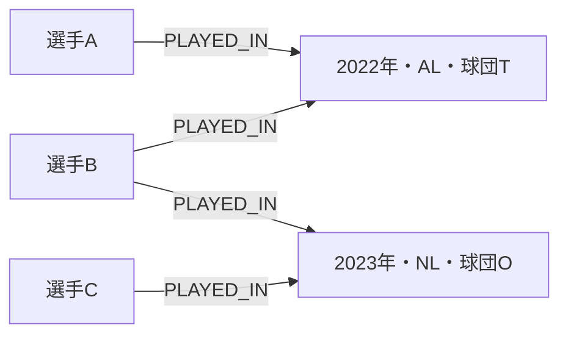

# neo4j

MLBの選手を「同じ年度・同じ球団に出場した」という関係でつなぎ、Neo4jとSQLiteで検索する学習プロジェクトです。

データ取得から再実行できるColabノートブック、グラフの設計、検索結果の一致検証、比較実験を公開します。
学習メモと考察の欄は、実行して理解した内容を自分の言葉で追記するためのものです。

## Colabで始める

| 順番 | 内容 | 開く |
|---|---|---|
| 01 | 公式CSVを取得、前処理、大谷翔平の所属履歴、図を表示。Neo4jアカウント不要 | [](https://colab.research.google.com/github/exkkt/neo4j/blob/main/notebooks/01_data_preparation.ipynb) |
| 02 | Neo4jへ登録、直接のつながり・2段階のつながりを検索 | [](https://colab.research.google.com/github/exkkt/neo4j/blob/main/notebooks/02_neo4j_analysis.ipynb) |
| 03 | 同じ答えが返ることを確認し、SQLiteとNeo4jの時間・書き方を比較 | [](https://colab.research.google.com/github/exkkt/neo4j/blob/main/notebooks/03_sql_comparison.ipynb) |

各ノートブックは単独で動きます。CPUランタイムを選び、上から順に実行してください。
PCにデータを保存する必要はありません。Colabから公式Boxの必要なCSVだけを取得します。
初期条件は **2015〜2025年・AL/NL・大谷翔平（`ohtansh01`）** です。

02・03では学習用の[Neo4j Auraインスタンス](https://console.neo4j.io/)などを用意します。
Colab左側のシークレットに `NEO4J_URI`・`NEO4J_USERNAME`・`NEO4J_PASSWORD` を登録し、ノートブックからのアクセスを許可してください。
値はコードやセル出力に残しません。シークレットが利用できない場合は非表示入力に切り替わります。
DBの作成・課金操作はこのリポジトリからは行いません。

GitHubへ自分の変更を保存する場合は、Colabの **ファイル → GitHubにコピーを保存** を使います。
実行環境のCSVや画像は、この操作ではアップロードされません。
Colabの実行環境が削除されたら、取得セルを再実行すれば同じデータを復元できます。

## 調べること

- 同じ年度・同じ球団に出場した選手は誰か。
- 直接のつながりを持たない選手に、1人を介してつながれるか。
- 同じ検索をSQLとCypherでどう表現するか。入力・結果をそろえた場合、観測時間はどう違うか。

## グラフの設計



`BaseballPlayer` と `BaseballTeamSeason` の二部グラフです。
球団だけでなく **年度・リーグ・球団ID** をキーにし、別の年度・リーグを混同しません。
同一年度の移籍は複数の所属関係として残します。重複行は所属関係を増やしません。
選手同士の関係をすべて事前生成せず、共通の球団・年度から検索します。

データ内容と年度条件から `dataset_id` を生成し、制約と `MERGE` で再実行時の重複を防ぎます。
年度を変えて取り込んでも検索対象が混ざりません。取り込み件数が一致してから完了マークを付けます。
異なる条件のデータはDBに残るため、容量に注意してください。削除処理は含めていません。

**解釈上の限界:** 年度別の出場記録だけでは、同じ日に在籍したことや同じ試合に出たことは分かりません。
本プロジェクトの「チームメート」は年度単位の定義です。つながりを時間の順にたどる制約は設けていません。
2段階検索では起点と直接のつながりを除き、最短で2段階の選手だけ返します。

## データと再現性

出典: [SABR Lahman Baseball Database](https://sabr.org/lahman-database/)

- Version 2025（2026-01-02公開、2026-02-18 CSV BOM更新）の公式Box配布ファイルを使用。
- `People.csv`、`Teams.csv`、`Appearances.csv` の3ファイルを直接取得。
- `sources.json` にファイルIDとSHA-256を固定。HTML・列不足・チェックサム不一致はエラー。
- `data/raw/manifest.json` に確認日時、出典、行数、チェックサムを記録。
- 元CSVをこのリポジトリには同梱しません。元データの権利は配布元・権利者に帰属します。利用条件は配布元を確認してください。
- AL/NL以外の記録は今回の対象に含めません。

公式ファイルが更新されてチェックサムが変わった場合は、バージョン・列・利用条件を確認した上で `sources.json` とノートブックを更新してください。
自動で別ミラーへ切り替えることはありません。

## 比較実験の読み方

03は、**ローカルのインメモリSQLiteとリモートNeo4jへのアクセス**を測定します。
入力データ、選手、段数、重複除去、並び順をそろえ、結果一致を確認してから測ります。
1回のウォームアップ後に5回測定し、中央値・最小・最大を記録します。結果全件の取得と通信を含みます。
両DBに検索用インデックスを作ります。キャッシュは初期化しません。

ネットワーク・マシン構成・インメモリ/サーバーの差を含むため、**Neo4jとSQLiteのエンジン単体の優劣は結論できません**。
結果は `outputs/comparison.csv`、環境と条件は `outputs/environment.json` に保存します。
DBのホスト名・認証情報は保存しません。

## ローカル開発

Python 3.12以降を推奨します。

```bash
python -m venv .venv
source .venv/bin/activate
python -m pip install -r requirements-dev.txt
python -m pytest -q
```

共通処理は `baseball_graph.py`、Colabへの組み込みは `scripts/build_notebooks.py` です。
共通処理やデータの固定版を変更したら以下を実行してください。

```bash
python scripts/build_notebooks.py
python -m pytest -q
```

ノートブックに共通処理を同梱するため、GitHubのコードを追加ダウンロードせずにColabだけで開始できます。
テストでは元モジュールとノートブック内のコードが一致することも確認します。

## 学習の進め方

1. 01で好きな選手を選び、所属履歴と図を読み、データの制約をメモする。
2. 02でCypherを読み、条件を変えて結果を確かめる。
3. 03で結果一致と時間を確認し、条件が変わると何が変わるか考察する。
4. READMEに「目的・設計理由・実行結果・限界・次の実験」を追記する。

## 検証状況

自動テスト14件、公式データでの前処理、ローカルNeo4jへの取り込み、SQLとの結果一致を確認しました。
ColabのシークレットUIとユーザーのAura接続は未検証です。
実測件数・環境・検証範囲は [検証記録](docs/verification.md) を参照してください。

## 参考資料

- [Neo4j Python Driver](https://neo4j.com/docs/python-manual/current/)
- [Cypher MERGE](https://neo4j.com/docs/cypher-manual/current/clauses/merge/)
- [ColabとGitHubの公式ガイド](https://github.com/googlecolab/colabtools/blob/main/notebooks/colab-github-demo.ipynb)
- [Colab FAQ](https://research.google.com/colaboratory/faq.html)
